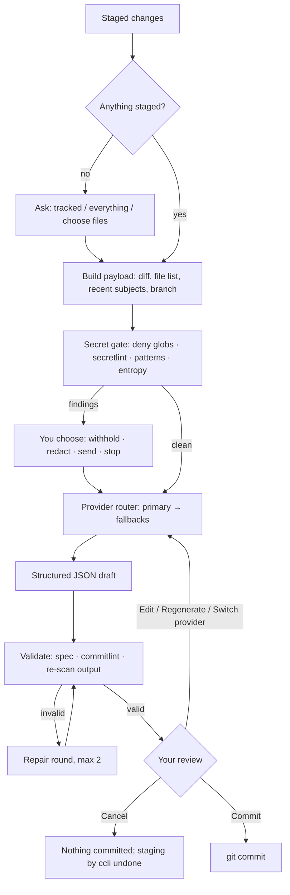

<div align="center">

# ✍️ conventional-commits-cli

**Conventional Commits, written by hand or by AI, always reviewed by you.**

Guided prompts for manual commits. AI-written messages from your staged changes with OpenAI, Anthropic, xAI or Gemini. Secret scanning before anything leaves your machine, automatic provider fallback, and nothing committed without your approval.

[](https://www.npmjs.com/package/@yourakshaw/conventional-commits-cli)
[](https://github.com/YourAKShaw/conventional-commits-cli/actions/workflows/ci.yml)
[](https://nodejs.org/)
[](https://www.conventionalcommits.org/en/v1.0.0/)
[](#-install)
[](LICENSE)

[Install](#-install) · [Quick start](#-quick-start) · [Smart commits](#-how-smart-commit-works) · [Configuration](docs/configuration.md) · [Privacy](docs/privacy-and-security.md) · [Contribute](.github/CONTRIBUTING.md)

</div>

---

## Why another commit tool?

Commit messages are read far more often than they are written: by reviewers, by `git log`, by changelog generators and by semantic-release. [Conventional Commits](https://www.conventionalcommits.org/en/v1.0.0/) makes them machine-readable, but writing them consistently is tedious, and handing your diff to an AI raises fair questions: what exactly is sent, what happens to the `.env` you staged by accident, and what if the provider is out of credits?

`conventional-commits-cli` (command: **`ccli`**) answers those questions explicitly:

> Every message is validated against the Conventional Commits 1.0.0 spec and your commitlint rules, every AI request is scanned for secrets first, and every commit waits for your approval.

## ⚙️ What it does

| Capability | What it means in practice |
| :--- | :--- |
| **Manual mode** | `ccli commit` walks you through type, scope, gitmoji, description, body, breaking change and issue references, with your repository's commitlint types and recent scopes as suggestions. |
| **Smart mode** | `ccli smart commit` writes the message from your staged diff with **OpenAI, Anthropic, xAI or Google Gemini**, then lets you commit, edit, regenerate with a hint, or switch provider. |
| **Provider fallback** | Configure a primary provider and fallbacks. When credits or quota run out, the next provider takes over automatically; transient errors get one bounded retry. |
| **Per-provider tuning** | Choose the model and reasoning effort for each provider (`reasoning.effort`, `output_config.effort`, `thinking_level`). |
| **Secret gate** | Sensitive files (`.env`, keys, credentials) are never sent. The exact payload is scanned with [secretlint](https://github.com/secretlint/secretlint), built-in patterns and an entropy check; you choose to withhold, redact, send or stop. |
| **Spec + commitlint validation** | Spec violations block the commit. Style rules from your commitlint config ask for explicit confirmation. AI output that fails validation is repaired automatically (up to two rounds). |
| **Mandatory review** | Nothing is committed without approval. Without a terminal, `ccli` never commits; `--print` outputs the message for your script to use. |
| **Safe by default for teams** | A repository's `.ccli.json` can tighten rules (allowed providers, extra deny globs, disable smart mode) but can never redirect your diffs to another endpoint. |
| **Cross-platform** | One npm package for Windows, macOS and Linux, plus optional standalone binaries that need no Node.js. |

## 📥 Install

**Requirements:** [Git](https://git-scm.com/) and, for the npm package, [Node.js 22.12 or later](https://nodejs.org/). Works on Windows, macOS and Linux (x64 and arm64).

### Run without installing (npx)

```sh
npx @yourakshaw/conventional-commits-cli commit
npx @yourakshaw/conventional-commits-cli smart commit
```

### Install globally (npm)

```sh
npm install --global @yourakshaw/conventional-commits-cli
ccli --version
```

This installs two equivalent commands: `ccli` and `conventional-commits-cli`. pnpm (`pnpm add -g`), Yarn (`yarn global add`) and Bun (`bun add -g`) work the same way.

### Add to a project (dev dependency)

```sh
npm install --save-dev @yourakshaw/conventional-commits-cli
npx ccli commit
```

### Standalone binaries (no Node.js)

Each [GitHub Release](https://github.com/YourAKShaw/conventional-commits-cli/releases) includes single-file executables with a `SHA256SUMS.txt`:

| Platform | File |
| :--- | :--- |
| Windows x64 / arm64 | `ccli-<version>-windows-x64.exe` / `ccli-<version>-windows-arm64.exe` |
| macOS Apple silicon / Intel | `ccli-<version>-darwin-arm64` / `ccli-<version>-darwin-x64` |
| Linux x64 / arm64 (glibc) | `ccli-<version>-linux-x64` / `ccli-<version>-linux-arm64` |
| Linux x64 / arm64 (musl, e.g. Alpine; needs `apk add libstdc++`) | `ccli-<version>-linux-x64-musl` / `ccli-<version>-linux-arm64-musl` |

Download the file for your platform, verify it, rename it to `ccli` (`ccli.exe` on Windows) and put it on your `PATH`:

```sh
sha256sum --check --ignore-missing SHA256SUMS.txt   # macOS: shasum -a 256 --check --ignore-missing SHA256SUMS.txt
chmod +x ccli-*-linux-x64 && mv ccli-*-linux-x64 ~/.local/bin/ccli
```

> [!NOTE]
> Binaries are not code-signed yet, so macOS Gatekeeper and Windows SmartScreen may warn on first run. They also do not include the OS keychain module: provide API keys through environment variables or the opt-in file store. See [distribution](docs/releasing.md#standalone-binaries).

## 🚀 Quick start

### Manual commit

```sh
git add src/math.js
ccli commit
```

```text
◇  Type of change             feat
◇  Scope                      math
◇  Gitmoji                    ✨  :sparkles:
◇  Short description          add sum helper
◇  Body (optional)
◇  Is this a breaking change? No
◇  Related issues (optional)  #7

   feat(math): ✨ add sum helper

   Refs: #7

◆  What would you like to do?
   ● Commit  ○ Edit in your editor  ○ Change type or scope  ○ Start over  ○ Cancel
```

Flags pre-fill any prompt: `ccli commit -t fix -s api -m "handle empty token"`. Add `--print` to output the message without committing (for scripts).

### Smart commit

```sh
# 1. Choose providers, models, effort, gitmoji and store API keys (once)
ccli config init

# 2. Stage, generate, review, commit
git add -A
ccli smart commit
```

Prefer environment variables? `ccli` reads `OPENAI_API_KEY`, `ANTHROPIC_API_KEY`, `XAI_API_KEY` and `GEMINI_API_KEY` (or `GOOGLE_API_KEY`) before anything else.

```sh
ccli smart commit --show-payload        # see exactly what would be sent; no network
ccli smart commit -P anthropic          # start with Anthropic, fall back to the others
ccli smart commit --model claude-sonnet-5-5 --effort medium -P anthropic
ccli smart commit --hint "focus on the API change" -- --signoff
```

## 🧩 How smart commit works



1. **Staging is your choice.** If nothing is staged, `ccli` asks what to include. Anything it staged is unstaged again if you cancel.
2. **First use of each provider asks for consent** to send diffs to it, and remembers your answer.
3. **The payload is scanned, not just the file names.** Generated files and lockfiles are summarized rather than sent; large diffs are trimmed to a token budget.
4. **The router** tries providers in your order. Credits or quota exhausted → next provider immediately (and that provider is skipped for 30 minutes). Rate limit with a short `Retry-After`, overload, network error or timeout → one retry, then next provider. Bad key or invalid model → next provider with a clear warning.
5. **The draft is validated** against the spec and your commitlint config; failures are sent back to the model to fix.
6. **You decide.** Commit, edit in your `$GIT_EDITOR`, change the type, regenerate (optionally with a hint), switch provider, or cancel. If the staged changes change while you review, `ccli` notices and asks again.

## 🤖 Providers

| Provider | Key variable | Default model | Default effort | Effort setting | API |
| :--- | :--- | :--- | :--- | :--- | :--- |
| **OpenAI** | `OPENAI_API_KEY` | `gpt-5.6-luna` | `low` | `reasoning.effort` | Responses API |
| **Anthropic** | `ANTHROPIC_API_KEY` | `claude-haiku-5-5` | `low` | `output_config.effort` | Messages API |
| **xAI** | `XAI_API_KEY` | `grok-4.7` | `low` | `reasoning.effort` | Responses API |
| **Google Gemini** | `GEMINI_API_KEY` or `GOOGLE_API_KEY` | `gemini-3.5-flash-lite` | `minimal` | `thinking_level` | Interactions API |

Defaults favour fast, low-cost models because a commit message is short structured output. Any model ID your account can use is accepted; `ccli models` lists the ones whose effort levels were verified against vendor documentation on **2026-10-19**. An unsupported effort is lowered to the nearest supported level with a warning, and `auto` lets the vendor decide.

`ccli` embeds no prices or rate limits, and asks providers not to store requests where the API supports it (`store: false`). Details, error classification and sources: [docs/providers.md](docs/providers.md).

```sh
ccli config set providers.order anthropic,openai,gemini   # primary first, then fallbacks
ccli config set providers.openai.model gpt-5.6-terra
ccli config set providers.openai.effort medium
ccli config set providers.xai.enabled false
ccli auth test                                             # one tiny request per provider
```

## 🔐 Privacy and secret protection

- **Only what is needed is sent:** the staged diff (trimmed to `smart.maxInputTokens`), the file list with line counts, up to 15 recent commit subjects and the branch name. Only to providers you approved. No telemetry.
- **Sensitive files never have their content sent**, even when staged: `.env*`, private keys (`*.pem`, `*.key`, `id_rsa*`…), keystores, `.npmrc`, `.netrc`, cloud credentials, `*.tfstate`, kubeconfigs and more. Templates such as `.env.example` and public keys (`*.pub`) are allowed. Add your own with `.ccliignore` or `secrets.extraDenyGlobs`.
- **Secrets inside ordinary files are detected** with secretlint's recommended rules, built-in patterns for common key formats, and an entropy check. You choose what happens; sending flagged content requires typing `send`.
- **The generated message is re-scanned** so a model cannot echo a secret into your history.
- **`ccli smart commit --show-payload`** prints the exact payload without contacting anyone.
- **API keys** are stored in the OS keychain (macOS Keychain, Windows Credential Manager, Linux Secret Service), or read from environment variables. A plaintext file store exists only behind `--insecure-file-store`.

Secret detection is best-effort, not a guarantee. Read the full model in [docs/privacy-and-security.md](docs/privacy-and-security.md).

## 🛠️ Commands

| Command | Purpose |
| :--- | :--- |
| `ccli commit` | Guided Conventional Commit for staged changes |
| `ccli smart commit` | AI-written message → review → commit |
| `ccli config init` | Guided setup: providers, order, models, effort, gitmoji, keys |
| `ccli config show` · `get` · `set` · `unset` · `path` | Inspect and change settings |
| `ccli auth set <provider>` · `remove` · `list` · `test` | Manage and check API keys |
| `ccli models [provider]` | Known models and effort levels |
| `ccli doctor` | Check Git, config, commitlint, keychain, keys and hook |
| `ccli hook install` · `uninstall` · `status` | Optional `prepare-commit-msg` hook for plain `git commit` |

<details>
<summary><strong>Options for <code>commit</code> and <code>smart commit</code></strong></summary>

| Option | `commit` | `smart commit` | Meaning |
| :--- | :---: | :---: | :--- |
| `-t, --type <type>` | ✓ | | Commit type, e.g. `feat` |
| `-s, --scope <scope>` | ✓ | | Scope (empty for none) |
| `-m, --message <text>` | ✓ | | Short description |
| `-b, --body <text>` | ✓ | | Body (`\n` for line breaks) |
| `--breaking [description]` | ✓ | | Mark as breaking change |
| `-f, --footer <footer>` | ✓ | | Footer such as `Refs: #123` (repeatable) |
| `-g, --gitmoji [code]` / `--no-gitmoji` | ✓ | ✓ | Add or omit the gitmoji |
| `-P, --provider <id>` | | ✓ | Start with this provider |
| `--model <id>` / `--effort <level>` | | ✓ | Override for the first provider |
| `--no-fallback` | | ✓ | Use only the first provider |
| `--hint <text>` | | ✓ | Extra guidance for the model |
| `--show-payload` | | ✓ | Print what would be sent, then exit |
| `-a, --all` | ✓ | ✓ | Stage modified tracked files first |
| `-p, --print` | ✓ | ✓ | Print the message instead of committing |
| `--retry` | ✓ | | Reuse the message saved after a failed `git commit` (e.g. a hook rejected it) |
| `-- <git args>` | ✓ | ✓ | Extra `git commit` options, e.g. `-- --no-verify --signoff` |

Global options: `-C, --cwd <path>`, `--verbose`, `--no-color`, `-v, --version`, `-h, --help`.

</details>

### Scripts and CI

Without an interactive terminal `ccli` never commits on its own. Use `--print` and let your script run `git commit`:

```sh
ccli commit -t chore -s deps -m "bump eslint" --print | git commit -F -
ccli smart commit --print > msg.txt   # needs a provider already approved for diffs
```

| Exit code | Meaning |
| :---: | :--- |
| `0` | Success |
| `1` | Error (message on stderr) |
| `2` | Invalid usage |
| `130` | Cancelled (Ctrl-C or Cancel); nothing committed |

## ⚙️ Configuration

Global settings live in `config.json` in your config directory (`ccli config path` prints it): `%APPDATA%\conventional-commits-cli` on Windows, `~/Library/Application Support/conventional-commits-cli` on macOS, `$XDG_CONFIG_HOME/conventional-commits-cli` or `~/.config/conventional-commits-cli` on Linux.

```jsonc
{
  "$schema": "https://raw.githubusercontent.com/YourAKShaw/conventional-commits-cli/main/schema/config.schema.json",
  "providers": {
    "order": ["anthropic", "openai", "gemini", "xai"],
    "anthropic": { "model": "claude-haiku-5-5", "effort": "low" },
    "openai": { "model": "gpt-5.6-luna", "effort": "low" }
  },
  "format": { "gitmoji": { "enabled": true, "style": "unicode", "position": "after-colon" } },
  "smart": { "language": "English", "maxInputTokens": 12000 }
}
```

A repository can add a **`.ccli.json`** that only restricts or shapes output:

```json
{
  "$schema": "https://raw.githubusercontent.com/YourAKShaw/conventional-commits-cli/main/schema/repo-config.schema.json",
  "format": { "scopes": ["api", "web", "docs"], "gitmoji": { "enabled": false } },
  "providers": { "allow": ["anthropic", "openai"] },
  "secrets": { "extraDenyGlobs": ["fixtures/customers/**"] }
}
```

Commit types and rules come from your commitlint config (`.commitlintrc`, `.commitlintrc.json` or the `commitlint` key in `package.json`), on top of `@commitlint/config-conventional`. JavaScript, TypeScript and YAML configs are not executed unless you opt in with `ccli config set commitlint.loadJsConfig true`, because that would run repository code. Every setting, environment variable and file is documented in [docs/configuration.md](docs/configuration.md).

### Gitmoji

Gitmoji are on by default and placed **after the colon** (`feat(api): ✨ add login`) so the header still parses as a Conventional Commit. Choose `"style": "code"` for `:sparkles:`, disable them with `ccli config set format.gitmoji.enabled false`, or use `"position": "prefix"` for `✨ feat(api): add login` (note that commitlint hooks and changelog tools usually reject that form).

## 🪝 Optional Git hook

Prefer plain `git commit`? Install a `prepare-commit-msg` hook in a repository:

```sh
ccli hook install
git add -A && git commit     # your editor opens with an AI suggestion
```

Saving the message is your approval; an empty message aborts as usual. The hook never runs for `-m`, `-F`, merges, amends or templates, and any failure falls back to Git's normal behaviour. Approve each provider once with `ccli smart commit` first.

## 📂 Inside the repository

```text
conventional-commits-cli/
├── src/
│   ├── cli.ts          # Entry point: signals, error reporting
│   ├── commands/       # commit, smart, review loop, auth, config, doctor, models, hook
│   ├── message/        # Draft model, renderer, parser, spec checks, commitlint bridge, gitmoji
│   ├── git/            # Git process layer, status, diff, staging, commit execution
│   ├── diff/           # Generated-file filter and token budgeting
│   ├── guard/          # Deny globs, secret patterns, payload scanning
│   ├── ai/             # Prompt, response schema, router, provider state, repair pipeline
│   ├── providers/      # OpenAI, Anthropic, xAI, Gemini adapters, error classifier, registry
│   ├── config/         # Paths, schema, loading, writing
│   ├── keys/           # Env → OS keychain → opt-in file store
│   └── ui/             # Prompts, spinner, editor
├── test/               # Unit, integration (real git) and end-to-end (built CLI + mock providers)
├── scripts/            # Build, JSON schema, binaries, real-terminal smoke test
├── schema/             # Generated JSON schemas for config files
├── docs/               # Architecture, configuration, providers, privacy, releasing, ADRs
└── .github/            # CI, release, CodeQL, Dependabot, issue/PR templates, community files
```

## 🧑‍💻 Development

```sh
git clone https://github.com/YourAKShaw/conventional-commits-cli.git
cd conventional-commits-cli
npm ci
npm run check              # lint, typecheck, unit + integration tests, build, end-to-end tests
node dist/cli.js --help    # run the built CLI
python3 scripts/tty-smoke.py   # drive the real prompts in a pseudo-terminal (macOS/Linux)
```

See [CONTRIBUTING.md](.github/CONTRIBUTING.md) for the full workflow, [docs/architecture.md](docs/architecture.md) for how the pieces fit, and [docs/releasing.md](docs/releasing.md) for publishing.

---

## 🤝 Contributing, support and security

Contributions are welcome. Start with the [contribution guide](.github/CONTRIBUTING.md), use the [issue forms](https://github.com/YourAKShaw/conventional-commits-cli/issues/new/choose), or read the [support guide](.github/SUPPORT.md). Please report vulnerabilities privately as described in the [security policy](.github/SECURITY.md).

## License

Distributed under the **MIT License**. See [LICENSE](LICENSE) for details. Bundled third-party licenses are listed in `dist/THIRD_PARTY_NOTICES.md` in the published package.
