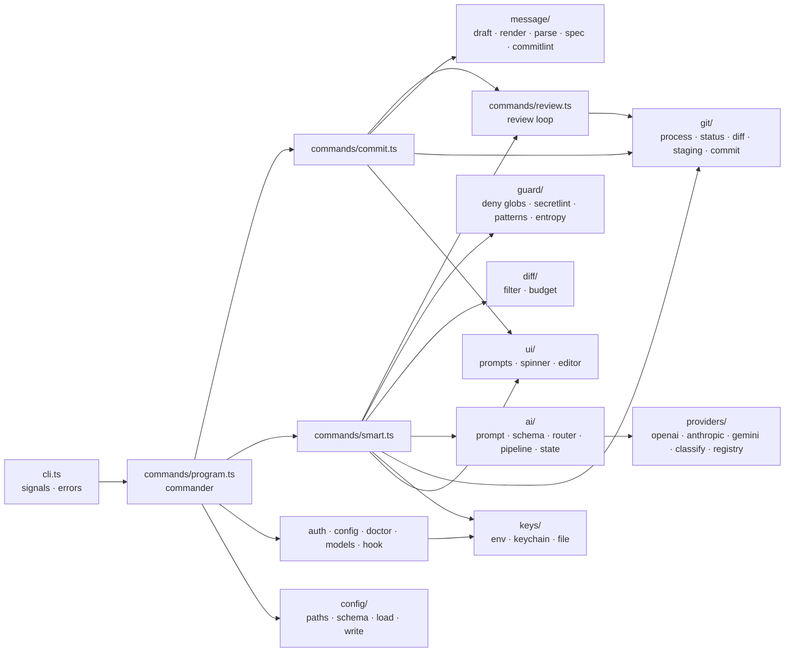
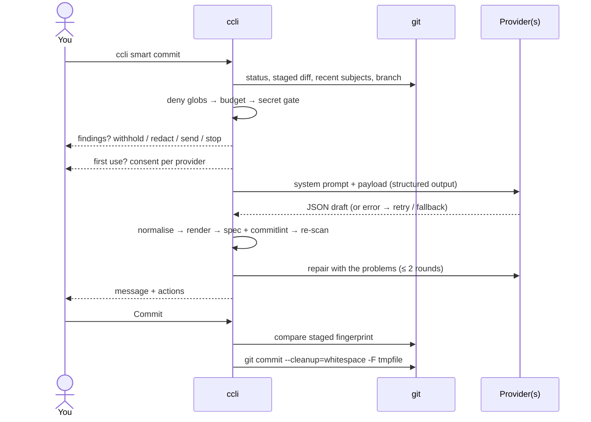

# Architecture

`ccli` is a single TypeScript program bundled into one ESM entry file (plus lazily loaded chunks) that runs on Node.js 22.12+ on every operating system Node supports. It shells out to `git` for everything repository-related and to provider HTTP APIs for smart mode. There is no daemon, no database and no telemetry.

## Module map

| Module | Responsibility | Notes |
| :--- | :--- | :--- |
| `cli.ts` | Entry point; maps errors to exit codes; two-stage Ctrl-C (first aborts the current operation, second exits 130) | Never prints stack traces unless `--verbose` |
| `commands/` | One file per command; `context.ts` loads repository, config, commitlint rules, types, scopes and history once per run | Command modules are imported on demand so `--help` and `--version` do not load zod, commitlint or secretlint |
| `commands/review.ts` | The shared review loop: commit, edit, change type or scope, regenerate, switch provider, start over, cancel | Re-checks the staged fingerprint before committing |
| `message/` | `CommitDraft` model, renderer (gitmoji, `!`, `BREAKING CHANGE`, footers, body wrapping), parser, Conventional Commits 1.0.0 checks, commitlint bridge, normaliser for model output | Spec errors block; commitlint errors need confirmation |
| `git/` | Spawns `git` without a shell; parses porcelain v2 status, name-status, numstat and patches; stages and unstages; commits from a temp file | `-c core.quotepath=off --no-pager`, `GIT_OPTIONAL_LOCKS=0`, NUL-separated pathspecs |
| `diff/` | Classifies lockfiles, generated and binary files; fits hunks to a token budget | Token estimate: `ceil(characters × 0.3)`, deliberately conservative |
| `guard/` | Path deny list, `.ccliignore`, secretlint, built-in patterns, entropy, redaction | Runs on the exact payload |
| `ai/` | Versioned prompt (`ccli-prompt-v1`), JSON schema, router with retry and fallback, provider state cache, generate → validate → repair pipeline | No tools are given to the model |
| `providers/` | One adapter per API (OpenAI and xAI share the Responses adapter), HTTP helper with timeouts and abort, error classifier, model and effort registry | Plain `fetch`, no SDKs |
| `config/` | Paths per OS, zod schemas, loading and merging global and repository config, atomic writes, JSON Schema generation | Repository config is restrict-only |
| `keys/` | Key resolution: environment → OS keychain (optional native module) → opt-in file | Keychain calls are async and time-bounded |
| `ui/` | `@clack/prompts`-based UI with a custom spinner; a plain UI for non-TTY use that refuses to prompt; editor integration | The plain UI writes to stderr so stdout stays clean for `--print` |

## Smart commit sequence

## Key invariants and where they are enforced

| Invariant | Enforced in | Tested in |
| :--- | :--- | :--- |
| No commit without approval | `review.ts` (only the *Commit* action calls `git commit`), `commit.ts`/`smart.ts` refuse without a TTY | `test/integration/flows.test.ts`, `test/e2e/cli.test.ts`, `scripts/tty-smoke.py` |
| No diff sent before consent | `ensureAcknowledged` in `smart.ts` | `flows.test.ts`, e2e |
| Denied files never sent | `buildSafePayload` in `smart.ts`, `guard/denylist.ts` | `test/unit/guard.test.ts`, e2e `--show-payload` |
| Flagged content not sent silently | `decideOnFindings` in `smart.ts` | `flows.test.ts` |
| Repository config cannot redirect | `REPO_FORBIDDEN_KEYS` + strict repository schema | `test/unit/config.test.ts` |
| Message describes what is committed | Staged fingerprint (`sha256` of `git diff --cached --raw`) checked before commit; passthrough blocklist | `flows.test.ts`, `git.test.ts` |
| Cancel restores staging done by ccli | `unstage` on `CancelledError` | `flows.test.ts`, TTY smoke (Ctrl-C) |
| Bounded cost and latency | Router: 2 attempts per provider, time budget, output cap; regeneration cap | `test/unit/router.test.ts` |

## Error handling

- Errors meant for users are `CliError` (message + optional hint + exit code). Anything else is a bug: `ccli` prints a short message with the issue tracker URL, and the stack only with `--verbose`.
- Provider failures are `ProviderError` with a `kind` that drives the router. When every provider fails, the error lists each attempt with its reason, so a misconfiguration is visible rather than hidden behind fallback.
- If `git commit` fails (for example a hook rejects the message), the message is saved to `CCLI_LAST_MESSAGE` in the Git directory and `ccli commit --retry` offers it again.

## Performance

The entry bundle contains only commander, the UI and the command router; everything else is in chunks loaded per command. On the development machine (Linux x64, Node 22) `ccli --version` measured 80–100 ms wall-clock; this is an indicative local measurement, not a guarantee. Smart-mode latency is dominated by the provider call.

## Build and packaging

| Script | Output |
| :--- | :--- |
| `npm run build` ([`scripts/build.mjs`](../scripts/build.mjs)) | esbuild bundle: `dist/cli.js` with a `#!/usr/bin/env node` banner, `dist/chunks/*.js`, and `dist/THIRD_PARTY_NOTICES.md` generated from the bundle's metafile |
| `npm run schema` | `schema/config.schema.json`, `schema/repo-config.schema.json` from the zod schemas |
| `npm run binaries` | `release/ccli-<version>-<target>[.exe]` for eight targets via `bun build --compile`, plus `SHA256SUMS.txt` |

All JavaScript dependencies are bundled and listed as `devDependencies`, so installing the package downloads nothing but the optional prebuilt keychain module. See [ADR 0001](adr/0001-typescript-bundled-for-node.md).

## Testing

| Layer | Location | What it covers |
| :--- | :--- | :--- |
| Unit | `test/unit/` | Renderer, spec checks, normaliser, gitmoji, commitlint bridge, secret gate, budgeter, git output parsers, provider request/response shapes and error classification, router, pipeline, config precedence and repository restrictions, generated schemas |
| Integration | `test/integration/` | Real `git` in temporary repositories: unborn branches, renames, Unicode and spaced paths, hooks, passthrough rules; full command flows with a scripted UI and mocked providers |
| End-to-end | `test/e2e/` | The built `dist/cli.js` as a subprocess against a local mock HTTP server for all four APIs, including fallback, `--show-payload`, keys via stdin, and the Git hook |
| Real terminal | `scripts/tty-smoke.py` | Drives the actual prompts in a pseudo-terminal: manual commit, smart commit, Ctrl-C (POSIX only) |

Tests never call real provider APIs. Fake secrets are assembled at runtime so the repository itself never contains strings that trip secret scanners. `test/setup.ts` isolates Git and `ccli` configuration from the developer's machine.

## Adding a provider

1. Add the ID to `PROVIDER_IDS` and an entry to the registry (`src/providers/registry.ts`) with verified models, effort values and sources.
2. Write an adapter (`ProviderAdapter`): build the request, parse the response, and throw `ProviderError` for truncation, refusals and malformed output. Reuse `postJson` from `http.ts` for timeouts and abort.
3. Add the provider's error codes to `classify.ts`, marking any inference as heuristic.
4. Add unit tests for request shape, parsing and every error class, and an e2e case in `test/e2e/mock-server.ts`.
5. Update `docs/providers.md`, the README and the CHANGELOG. Run `npm run schema` (the provider ID appears in the config schema).
