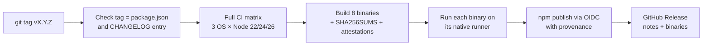

# Releasing and distribution

One Git tag produces every release artifact:



The workflow is [`.github/workflows/release.yml`](../.github/workflows/release.yml). npm is published only after CI and every binary check pass, and the GitHub Release is created only after npm succeeds.

## Artifacts

| Artifact | Audience | Notes |
| :--- | :--- | :--- |
| npm package `@yourakshaw/conventional-commits-cli` | Anyone with Node.js 22.12+ | Platform-independent bundled JavaScript, so one package serves Windows, macOS and Linux on any CPU Node supports. The only runtime dependency is the optional `@napi-rs/keyring`, which npm resolves to a prebuilt binary for the user's OS and CPU |
| Standalone binaries | Machines without Node.js | `bun build --compile` executables for Linux x64/arm64 (glibc and musl), macOS x64/arm64, Windows x64/arm64 |
| `SHA256SUMS.txt` and GitHub artifact attestations | Verification | `sha256sum --check`, or `gh attestation verify <file> --repo YourAKShaw/conventional-commits-cli` |

## One-time setup

These steps need your accounts and cannot be automated from the repository.

### 1. Repository

1. Create `github.com/YourAKShaw/conventional-commits-cli` and push `main`. If you use a different owner or name, update `repository`, `homepage` and `bugs` in `package.json`, the URLs in `src/meta.ts`, the README badges, the `$schema` URLs in `src/config/write.ts` and the docs, and `CODEOWNERS`.
2. **Settings → Code security:** enable Dependabot alerts and security updates, secret scanning with push protection, and **private vulnerability reporting** (used by [SECURITY.md](../.github/SECURITY.md)). CodeQL runs from [`codeql.yml`](../.github/workflows/codeql.yml); if you enable CodeQL "default setup" instead, delete that workflow to avoid duplicate analyses.
3. **Settings → Rules:** protect `main` (require pull requests and the `CI` checks; block force pushes). Optionally add a tag ruleset restricting who can create `v*` tags, since a tag triggers a publish.
4. **Settings → Environments:** create an environment named **`npm`** and, optionally, add yourself as a required reviewer so every publish waits for a click. The workflow creates the environment automatically if it does not exist, but without protection rules.
5. **Settings → Actions → General:** keep the default `GITHUB_TOKEN` permission at read-only; the workflows request what they need per job.

### 2. npm package name

The unscoped name `conventional-commits-cli` is already taken on npm by another publisher (checked 2026-10-19), so the package is scoped: `@yourakshaw/conventional-commits-cli`. The commands stay `ccli` and `conventional-commits-cli`.

A scope must be your npm username or an npm organization you own. If your npm username is not `yourakshaw`, change `name` in `package.json`, `PACKAGE_NAME` in `src/meta.ts`, and the install commands in the README, this page and `release.yml`.

### 3. First publish

npm's trusted-publisher settings live on the package's settings page, which exists only after the package has been published at least once. So the very first version is published from your machine:

```sh
npm login                         # an account with two-factor authentication
git switch main && git pull
npm ci
npm run check                     # lint, types, tests, build, e2e
npm publish --access public       # prepack builds dist/ first
```

This first version will not have provenance. Alternatively, publish a `0.0.0` placeholder this way and let the workflow publish `0.1.0` with provenance.

### 4. Trusted publishing (OIDC)

On [npmjs.com](https://www.npmjs.com/), open the package → **Settings** → **Trusted Publisher** → **GitHub Actions**, and enter:

| Field | Value |
| :--- | :--- |
| Organization or user | `YourAKShaw` |
| Repository | `conventional-commits-cli` |
| Workflow filename | `release.yml` |
| Environment name | `npm` |

Then, under **Publishing access**, choose to require two-factor authentication and disallow tokens, so the workflow is the only way to publish. npm notes that a newly created trusted-publisher configuration must complete its first successful publish within two days.

Requirements the workflow already meets: npm CLI 11.5.1 or later (the job checks and upgrades if needed), Node.js 22.14+ (it uses 24), `id-token: write`, a GitHub-hosted runner, and `repository.url` in `package.json` matching the GitHub repository exactly. Provenance is generated automatically for public packages published from public repositories. If the configuration does not match the workflow run exactly, npm answers with a misleading `E404`.

## Cutting a release

1. Move the **Unreleased** entries in `CHANGELOG.md` under a new `## [X.Y.Z] - YYYY-MM-DD` heading and update the comparison links at the bottom.
2. If provider data changed, re-verify it (see [providers](providers.md#updating-the-registry-maintainers)).
3. Bump the version, commit and tag in one step, then push:

   ```sh
   npm version X.Y.Z -m "chore(release): %s"   # updates package.json and package-lock.json, commits, tags vX.Y.Z
   git push --follow-tags
   ```

4. Watch the **Release** workflow. If you configured a reviewer on the `npm` environment, approve the publish job.
5. Check the result:

   ```sh
   npm view @yourakshaw/conventional-commits-cli version
   npx @yourakshaw/conventional-commits-cli@X.Y.Z --version
   npm audit signatures            # in a project that depends on it: verifies signatures and provenance
   ```

**Prereleases:** a version with a hyphen (`0.2.0-beta.1`) is published under the `next` dist-tag and marked as a prerelease on GitHub, so `npm install` users are unaffected. Install it with `@next`.

### If something goes wrong

| Situation | What to do |
| :--- | :--- |
| Tag/version/CHANGELOG check fails | Nothing was published. Fix, delete the tag (`git push --delete origin vX.Y.Z && git tag -d vX.Y.Z`), and tag again |
| CI or binary checks fail | Nothing was published. Fix on `main`, then re-tag as above |
| npm publish fails | Usually trusted-publisher configuration (E404) or a version that already exists. Fix and re-run the failed jobs |
| GitHub Release step fails after npm succeeded | Re-run the failed job; npm is not touched again |
| A bad version reached npm | Publish a fixed patch release, then `npm deprecate @yourakshaw/conventional-commits-cli@X.Y.Z "<reason>, use X.Y.Z+1"`. Prefer this over unpublishing, which npm restricts ([policy](https://docs.npmjs.com/policies/unpublish)) and which breaks anyone who installed it |

## Standalone binaries

Built by [`scripts/build-binaries.mjs`](../scripts/build-binaries.mjs) with Bun (version pinned in `release.yml`):

```sh
npm run binaries                                   # all eight targets into release/
npm run binaries -- --only=bun-linux-x64,bun-darwin-arm64
```

Known limitations:

- **No OS keychain.** The native keychain module is not embedded, so binaries read keys from environment variables or the opt-in file store (`ccli auth set <provider> --insecure-file-store`). `ccli doctor` reports this.
- **Not code-signed or notarized.** macOS may block the first run (right-click → Open, or `xattr -d com.apple.quarantine ./ccli`), and Windows SmartScreen may warn. Signing needs an Apple Developer ID and a Windows code-signing certificate; add those steps to the `binaries` job when available.
- **musl builds need `libstdc++`** (`apk add libstdc++` on Alpine).
- Each binary is 60–90 MB because it embeds the Bun runtime.

Every binary is executed on a native runner for its platform before publishing (`--version` plus a manual-mode `--print` in a fresh repository); the musl builds run in an Alpine container.

## Not yet automated

- Homebrew, Scoop and winget manifests (can be generated from the release's checksums).
- A scheduled live smoke test against real provider APIs. It needs low-limit API keys stored as repository secrets; until then, run `ccli auth test` manually before each release.
